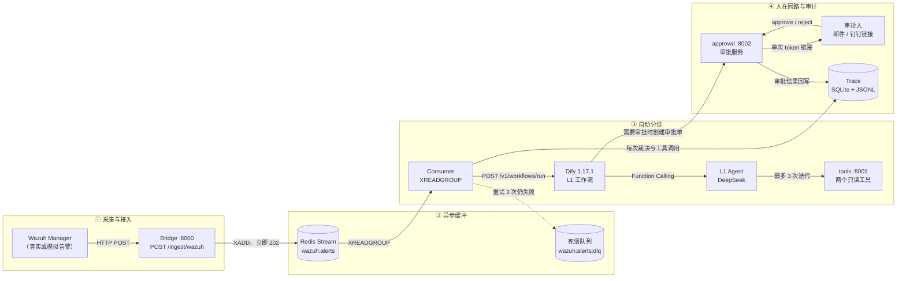

# SOC-Agent-L1

> Wazuh 告警自动分诊 Agent：**异步解耦 + Agentic SOC + 人在回路**，已在云端 **Dify 1.17.1** 完成真实端到端联调。

SOC-Agent-L1 面向 L1 安全运营场景：Wazuh 告警经 Redis Stream 异步进入 Dify 工作流，由 L1 Agent 调用两个只读工具完成研判，输出 `close / watch / escalate`。涉及阻断、隔离等破坏性动作时，系统只生成审批建议，由人工通过单次有效链接批准或拒绝；全链路写入可查询、可审计的 Trace。

---

## 1. 项目简介

传统 SOC 的 L1 值班面临两个现实问题：告警量大导致“告警疲劳”，而直接把大模型接进安全链路又引入新的风险（误判、越权、不可审计）。本项目把两者拆开处理：**研判可以自动化，破坏性动作必须留在人的手里。**

四个核心亮点：

| 亮点 | 具体实现 |
| --- | --- |
| **异步解耦** | Wazuh → Bridge → Redis Stream → Consumer。Bridge 收到告警立即返回 `202`，消费失败重试 3 次后进入 DLQ，采集侧不被 LLM 延迟拖垮。 |
| **Agentic SOC** | Dify Agent 使用 Function Calling 调用 `fetch_wazuh_alerts`、`search_attack_knowledge` 两个只读工具，最多 3 次迭代，最终收敛为四字段强约束输出。 |
| **人在回路** | 破坏性动作只出建议、不执行。审批单使用 24 小时有效、单次使用的 token；审批结果回写 Trace，重复提交返回 `already_decided`。 |
| **Dify 1.17 适配** | 已修复 1.17 的 DSL Schema 变更、SSRF 私网拦截、Agent 输出 JSON 转义、审批节点重复创建等深水区问题，详见 [核心痛点与解决方案](#4-核心痛点与解决方案) 与 [docs/CLOUD_DEPLOY.md](docs/CLOUD_DEPLOY.md) 第 9 节。 |

> **当前状态**：腾讯云 4C4G + Dify 1.17.1 + Redis 7 真实联调通过。批次 `6e4fab24` 的 3 条告警全部完成裁决（`close` 1 条、`escalate` 2 条），审批的批准、拒绝、防重放路径均已验证。实测数据见 [第 5 节](#5-实测验证)。

---

## 2. 系统架构



**一次告警的完整路径：**

1. Wazuh 或注入脚本调用 Bridge `POST /ingest/wazuh`，Bridge 归一化后 `XADD` 到 `wazuh:alerts`，立即返回 `202` 和 `trace_id`。
2. Consumer 以 consumer group `soc-l1` 读取消息，调用 Dify `POST /v1/workflows/run`（`response_mode=blocking`）。
3. Dify 先做告警归一化，再交给 L1 Agent；Agent 按需调用两个只读工具，最多 3 次。
4. “校验与安全收敛”节点把输出裁剪为四字段 Schema，并判断是否需要人工审批。
5. 需要审批时，审批服务创建 `approval_id`，生成单次有效链接，通过邮件或钉钉下发；审批结果回写数据库。
6. Consumer 将 `runs / steps / approvals` 写入 SQLite，同时追加 JSONL 审计日志；失败消息重试 3 次后进入 DLQ。

**组件与端口：**

| 组件 | 默认端口 | 暴露范围 |
| --- | --- | --- |
| Bridge | `8000` | 仅内网 / 受 `BRIDGE_TOKEN` 保护 |
| tools（只读工具） | `8001` | 仅内网 / 受 `TOOL_API_TOKEN` 保护 |
| approval（审批） | `8002` | 审批链接需要对外；管理接口受 `APPROVAL_API_TOKEN` 保护 |
| Redis Stream | `6379` | **仅监听 `127.0.0.1`**，禁止公网开放 |
| Dify | `8081 / 8443` | 本项目云端为避开已占用的 80/443 使用该端口，按实际部署调整 |
| mock-dify | `8003` | 仅本地演示，生产不启用 |

**为什么用 Redis Stream 而不是直接 HTTP 调用 Dify？**

- **削峰**：告警突发时先入队，Consumer 按自身能力消费，不会把 Dify 打满。
- **可恢复**：consumer group + Pending Entries List（PEL）保证进程崩溃后消息可被重新认领，不会丢告警。
- **故障隔离**：Dify 超时或工具异常只影响单条消息；重试耗尽后进入 DLQ，不阻塞后续队列。
- **可观测**：`XPENDING`、`lag`、DLQ 长度直接构成运行健康指标。

---

## 3. 核心设计

### 3.1 四字段 Schema 强约束

对外输出固定为：

```json
{
  "decision": "close | watch | escalate",
  "confidence": 0.0,
  "reason": "不超过 50 字",
  "evidence": [
    {
      "tool": "fetch_wazuh_alerts | search_attack_knowledge | alert_rule | policy",
      "params": {},
      "key_finding": "关键发现"
    }
  ]
}
```

约束点：

- Pydantic `extra="forbid"`：模型不能偷偷扩展字段。
- `evidence` 最多 8 条，`reason` 最多 50 字，避免“长篇大论但不可执行”。
- 破坏性建议只能通过 `policy` evidence 表达，且必须带 `destructive=true`、`requires_approval=true`。
- 输出会被校验两次：Dify 的“校验与安全收敛”code 节点一次，Consumer 侧 Pydantic 再校验一次。

### 3.2 双工具 + 3 次迭代限制

| 工具 | 作用 | 安全边界 |
| --- | --- | --- |
| `fetch_wazuh_alerts` | 按 `src_ip`、`min_level`、`limit` 查询历史告警，返回重复次数与聚合统计 | 只读；参数白名单；不返回凭证 |
| `search_attack_knowledge` | 检索 MITRE ATT&CK 子集与 IOC 观察列表，解释行为、补充证据 | 只读；本地知识库或 Dify 数据集 |

Prompt 明确限制“最多 3 次工具调用”，并要求先解释行为、再查同源 IP 重复情况。工具参数同样使用 Pydantic `extra="forbid"`，非法 IP、空 query 会被直接拒绝。

### 3.3 人在回路审批机制

- **只建议、不执行**：L1 不执行 `block_ip`、`isolate_host` 等动作，审批通过后仍由 L2 执行器校验并执行。
- **单次 token**：审批 token 只以明文形式出现在生成链接中，SQLite 仅保存 `token_hash`；默认 24 小时过期。
- **防重放**：同一链接第二次提交返回 `already_decided`；API 与网页链接共用同一套校验。
- **可追溯**：`approvals` 表记录 `status / decided_at / decided_by / note`，并同步写入 Trace。

---

## 4. 核心痛点与解决方案

这一节记录的是真实联调中卡住系统的问题，不是“预研阶段的风险清单”。

### 4.1 Dify SSRF 拦截私网地址

**现象**：Dify 工作流调用 `http://host.docker.internal:8001/tools/...` 或审批服务时失败，`ssrf_proxy` 返回 403，Agent 无法获取工具结果，审批单也创建不出来。

**根因**：Dify 1.17 自带的 `ssrf_proxy`（squid）默认拒绝私网和 Docker 网段。容器里的 `127.0.0.1` 指向容器自身，必须走宿主机地址；而该地址又正好落在 SSRF 防护范围内。

**解决**：

1. 在 Dify 的 `.env` 中开启 `SSRF_PROXY_ALLOW_PRIVATE_IPS=true`。
2. 只放行实际使用的 Docker 网段，例如 `172.17.0.0/16`，由入口脚本生成 `/etc/squid/dify_allow_private.conf` 中的 squid ACL。
3. 重启 `ssrf_proxy`、`api`、`worker`，从 Dify 容器内验证：

```bash
docker compose exec api python -c \
  "import urllib.request; print(urllib.request.urlopen('http://host.docker.internal:8001/health', timeout=3).status)"
```

**边界**：只放行容器网段，不要写成 `0.0.0.0/0`；生产环境更推荐用内网域名 + TLS，而不是长期依赖 `host.docker.internal`。

### 4.2 Agent 输出 JSON 嵌套破裂

**现象**：Dify 工作流显示成功，但 Consumer 报 `result_json 不是合法 JSON`，或审批接口返回 `422 result_json 不符合 L1 Schema`；日志里能看到大量 `\"` 被多转义了一层。

**根因**：Agent 输出是 JSON 文本，而审批 HTTP body 要求把整段 JSON 作为 `result_json` 字符串字段嵌入。只做一层 `json.dumps` 时，内层引号没有正确转义，body 会被截断；转义层数不对时，审批服务又会把 `result_json` 当成普通字符串，无法通过 `model_validate_json`。这就是“JSON 里套 JSON 字符串”的破裂点。

**解决**：

- 在“校验与安全收敛”节点先把 Agent 的 `text` 解析为对象，校验、裁剪并补齐 policy evidence，然后输出两级转义结果：

```python
standard = {"decision": ..., "confidence": ..., "reason": ..., "evidence": [...]}
result_json = json.dumps(standard, ensure_ascii=False)             # 语义输出的 JSON 文本
result_json_escaped = json.dumps(result_json, ensure_ascii=False)  # 作为字符串字段嵌入 body
```

- 审批 HTTP 节点的 body 配置只保留一个 `body` item（1.17 的 `_require_single_body_item` 限制），模板写 `"result_json": {{#validate.result_json_escaped#}}`，变量**不加引号**，最终 body 才是合法的 JSON 字符串字段。
- 审批服务以 `result_json: str` 接收，再用 `L1Output.model_validate_json()` 解析；Consumer 的 `_parse_outputs` 同时兼容字符串和对象，作为最后一道兜底。

**结果**：批次 `6e4fab24` 的 3 条告警全部通过 Schema 校验，审批接口没有再出现 422。

### 4.3 审批节点重复创建

**现象**：一条 `escalate` 告警生成两条审批单；批准其中一条后，另一条一直挂在 `pending`，审计链出现分叉。

**根因**：Dify 已经通过 HTTP 节点创建了审批，但 1.17 把响应体放在字符串字段 `approval.body` 中；结束节点按对象字段映射 `approval_id` 时拿到空值。Consumer 收到“需要审批但没有审批号”的结果，触发兜底逻辑再建一条，最终同一 trace 出现两条审批。

**解决**：

1. 在审批 HTTP 节点后新增 `approval_parse` code 节点，显式解析字符串响应：

```python
data = json.loads(approval_body)
return {"approval_id": str(data.get("approval_id") or "")}
```

2. 结束节点只输出 `approval_parse.approval_id`，不再直接引用 HTTP 节点的嵌套字段。
3. Consumer 仅在 `approval_id` 为空时兜底创建；正常路径拿到审批号后不会触发。

**结果**：批次 `6e4fab24` 中两条 `escalate` 告警各只生成 1 条审批单，Consumer 未再重复兜底创建。

### 4.4 Dify 1.17 其他兼容修复

| 问题 | 1.17 的要求 | 处理 |
| --- | --- | --- |
| HTTP 节点 `params` 类型 | 必须是字符串 | DSL 中改为 `params: ""`，查询参数放到 `url` / body |
| 超时字段 | 只认 `connect / read / write` | 删除旧的单值 `timeout`，改为三段式 |
| 失败策略 | 枚举值变化 | 使用 `error_strategy: default-value` |
| Agent 输出变量 | 变量名是 `text` | 下游统一引用 `[agent, text]` |
| 模型绑定 | 需要 `model_type: llm` | 在模型 value 中显式声明 |
| 审批响应解析 | body 是字符串 | 新增 `approval_parse` 节点（见 4.3） |

完整差异与复现步骤见 [docs/CLOUD_DEPLOY.md](docs/CLOUD_DEPLOY.md) 第 9 节。

---

## 5. 实测验证

### 5.1 联调环境

| 项目 | 配置 |
| --- | --- |
| 云服务器 | 腾讯云 4 核 4 GB |
| Dify | 1.17.1（Docker Compose，API 端口 `8081`） |
| 模型 | DeepSeek `deepseek-flash`（Dify 插件） |
| 队列 | Redis 7，`noeviction`，仅监听 `127.0.0.1:6379` |
| 运行时 | Python 3.11，四个 systemd 服务 |
| 告警来源 | `scripts/inject_soc_alert.py` 按 Wazuh 集成格式注入（`WAZUH_MODE=mock`） |
| 联调批次 | `6e4fab24` |

### 5.2 三条告警的最终裁决

| # | 告警 | level | 裁决 | 审批单 | 最终结果 |
| --- | --- | --- | --- | --- | --- |
| 1 | SSH 暴力破解（T1110，源 IP `203.0.113.45`） | 10 | `escalate` | `apr_822e3700760e` | 人工 **reject**，验证拒绝路径 |
| 2 | Web 健康检查误报（`GET /health`） | 3 | `close` | 无 | 自动关闭，不进入审批 |
| 3 | 可疑 PowerShell 编码命令（T1059.001） | 12 | `escalate` | `apr_8bcdbcc1c979` | 人工 **approve**，验证批准路径 |

对应 trace_id 为 `trc_inject_6e4fab24_1`、`trc_inject_6e4fab24_2`、`trc_inject_6e4fab24_3`。

### 5.3 审批闭环与防重放

- 批准与拒绝都成功写入 `approvals`：`status=approve/reject`、`decided_at`、`decided_by=e2e-verify`、`note`。
- 审批完成后再次用同一 token 调用 API，返回 400 与：

```json
{"detail": "already_decided"}
```

通过网页链接重放时，页面会显示“该审批已处理，不能重复提交”。

- 明文 token 只存在于 Dify 审批节点返回的 `preview.approve_url / reject_url`；SQLite 中只有 `token_hash`，数据库泄露不能直接重放审批。

### 5.4 队列与死信

| 指标 | 实测值 |
| --- | --- |
| `XPENDING wazuh:alerts soc-l1` | `pending=0` |
| `XINFO GROUPS wazuh:alerts` | `lag=0`，`entries-read=27` |
| DLQ | 保留 21 条历史失败消息 |

DLQ 中的 21 条是联调早期留下的历史消息，保留用于演示死信隔离机制；批次 `6e4fab24` 没有新增死信。

### 5.5 端到端延迟

| 指标 | 结果 |
| --- | --- |
| Consumer 收到消息 → Dify 工作流返回（含工具调用与审批建单） | **[端到端延迟]** |

测量口径：`runs.latency_ms`，从 Consumer 开始处理该消息到 Dify 返回并落库。可用以下 SQL 复核：

```sql
SELECT trace_id, alert_id, verdict, latency_ms
FROM runs
WHERE trace_id LIKE 'trc_inject_6e4fab24%'
ORDER BY received_at;
```

### 5.6 联调结论

- 3/3 告警完成自动分诊：1 条 `close`，2 条 `escalate`。
- 2/2 `escalate` 各只创建 1 条审批单，无重复、无悬挂。
- 批准、拒绝、防重放三条路径全部通过。
- Consumer 无重复消费；Redis `pending=0`、`lag=0`。
- 全链路 Trace 可按 `trace_id` 重建，包含每次工具调用、裁决与审批结果。

---

## 6. 快速启动

以下步骤以 Linux + systemd 为准，路径与仓库中的 unit 文件保持一致：`/opt/soc-agent-l1`。

### 6.1 前置条件

- Python 3.11+
- Docker + Docker Compose v2（只用于 Redis；Dify 可独立部署）
- 可访问的 Dify 1.17.x
- 4 核 4 GB 起步；Dify 整栈内存参考 [deploy/dify-cloud-4c4g.override.yml](deploy/dify-cloud-4c4g.override.yml)

### 6.2 安装依赖

```bash
cd /opt/soc-agent-l1

sudo python3 -m venv .venv
sudo .venv/bin/pip install -U pip
sudo .venv/bin/pip install -r requirements.txt
sudo .venv/bin/pip install -e .

sudo useradd --system --home /opt/soc-agent-l1 --shell /usr/sbin/nologin socagent 2>/dev/null || true
sudo mkdir -p data runtime
sudo chown -R socagent:socagent data runtime
```

### 6.3 配置 `/etc/soc-agent-l1.env`

```bash
sudo cp .env.example /etc/soc-agent-l1.env
sudo chmod 600 /etc/soc-agent-l1.env
sudo editor /etc/soc-agent-l1.env
```

至少确认以下变量：

| 变量 | 示例 | 说明 |
| --- | --- | --- |
| `REDIS_URL` | `redis://127.0.0.1:6379/0` | 云端 Redis 仅监听本机 |
| `DIFY_MODE` | `api` | 真实联调不能再用 `mock` |
| `DIFY_API_BASE` | `http://127.0.0.1:8081/v1` | 按实际 Dify 端口调整 |
| `DIFY_API_KEY` | `<YOUR_API_KEY>` | Dify 应用 API Key |
| `WAZUH_MODE` | `mock` 或 `indexer` | 接真实 Indexer 时改为 `indexer` |
| `TOOL_API_TOKEN` | `openssl rand -hex 32` 生成 | Dify 调 tools 的 Bearer Token |
| `APPROVAL_API_TOKEN` | `openssl rand -hex 32` 生成 | 管理接口 Token |
| `BRIDGE_TOKEN` | `openssl rand -hex 32` 生成 | Wazuh / 注入端 Token |
| `APPROVAL_PUBLIC_URL` | `https://<YOUR_DOMAIN>` | 审批链接的公网地址 |
| `APPROVAL_EXPOSE_LINKS` | 生产设为 `false` | 只通过邮件/钉钉下发链接 |

> 不要把 `/etc/soc-agent-l1.env`、`.env` 或任何真实 Key 提交到 Git。

### 6.4 启动 Redis

```bash
# 仓库根目录没有 .env 时，compose 会读取它作为服务环境变量
cp .env.example .env

docker compose -f deploy/docker-compose.yml up -d redis
docker compose -f deploy/docker-compose.yml ps redis
```

该 compose 将 Redis 绑定在 `127.0.0.1:6379`，并使用 `noeviction`，避免告警被当作缓存淘汰。

### 6.5 启动四个 systemd 服务

```bash
sudo cp deploy/systemd/soc-*.service /etc/systemd/system/
sudo systemctl daemon-reload
sudo systemctl enable --now soc-tools.service soc-approval.service soc-bridge.service soc-consumer.service
sudo systemctl status soc-tools soc-approval soc-bridge soc-consumer --no-pager
```

| 服务 | 作用 | 健康检查 |
| --- | --- | --- |
| `soc-tools` | 两个只读工具 | `curl -fsS http://127.0.0.1:8001/health` |
| `soc-approval` | 审批与防重放 | `curl -fsS http://127.0.0.1:8002/health` |
| `soc-bridge` | Wazuh 接入与入队 | `curl -fsS http://127.0.0.1:8000/health` |
| `soc-consumer` | 消费队列、调用 Dify、落 Trace | `sudo journalctl -u soc-consumer -f` |

### 6.6 注入 3 条告警

在服务器上直接执行（脚本默认连接 `127.0.0.1:6379`）：

```bash
cd /opt/soc-agent-l1
.venv/bin/python scripts/inject_soc_alert.py
```

先预览、不写 Redis：

```bash
.venv/bin/python scripts/inject_soc_alert.py --dry-run
```

从本地开发机注入时，先建 SSH 隧道，再运行脚本：

```bash
# 终端 1：把云端 Redis 映射到本地 6379
ssh -N -L 6379:127.0.0.1:6379 <USER>@<YOUR_IP>

# 终端 2：在项目根目录执行
python scripts/inject_soc_alert.py
```

脚本会输出 `Batch: <8 位批次号>`，以及 3 条告警的 `level / rule_id / alert_id / trace_id / message_id`。

### 6.7 观察结果

```bash
# Consumer 日志
sudo journalctl -u soc-consumer -f

# 队列健康
redis-cli XINFO GROUPS wazuh:alerts
redis-cli XPENDING wazuh:alerts soc-l1

# 最近裁决
sqlite3 /opt/soc-agent-l1/runtime/traces.sqlite3 \
  "SELECT trace_id, alert_id, verdict, confidence, latency_ms
   FROM runs ORDER BY received_at DESC LIMIT 5;"
```

审批列表（需要管理 Token）：

```bash
curl -fsS -H "Authorization: Bearer <APPROVAL_API_TOKEN>" \
  http://127.0.0.1:8002/approvals?limit=5
```

---

## 7. 目录结构

```text
soc-agent-l1/
├─ src/soc_agent/                 # bridge / consumer / approval / tools / trace / models
├─ dify/
│  ├─ l1-triage.workflow.yml      # Dify 1.17 DSL（含 approval_parse 节点）
│  └─ tools/                      # 工具 OpenAPI 描述
├─ deploy/
│  ├─ systemd/                    # 四个 systemd unit
│  ├─ docker-compose.yml          # 单机 Redis + 服务编排
│  └─ dify-cloud-4c4g.override.yml
├─ scripts/inject_soc_alert.py    # 注入 3 条典型 Wazuh 告警
├─ tests/                         # Schema / 工具 / 审批 / 队列 / DSL 测试
├─ docs/                          # 部署、架构、验收、可观测性文档
├─ data/                          # 合成告警、ATT&CK 子集、IOC
└─ README.md
```

---

## 8. 本地开发与测试

```bash
python -m venv .venv
# Windows: .venv\Scripts\activate
source .venv/bin/activate

pip install -r requirements.txt -r requirements-dev.txt
pip install -e .

pytest -q
```

离线跑通 5 条模拟告警（不依赖 Redis / Dify）：

```bash
python -m soc_agent demo --limit 5
```

仅启动 mock Dify（用于验证 HTTP 契约）：

```bash
python -m soc_agent serve mock-dify --port 8003
```

真实联调必须使用 `DIFY_MODE=api`，并保证 Dify 工作流已导入、两个工具已绑定、审批服务可被 Dify 访问。

---

## 9. 安全边界与已知限制

**安全边界：**

- Redis `6379`、tools `8001`、approval `8002` 不对公网开放；安全组只放行必要端口。
- 所有服务间调用使用独立 Token；Token 只从环境变量读取。
- 审批 token 单次有效、默认 24 小时过期，数据库只存哈希。
- L1 永不执行破坏性动作；审批结果只是 L2 执行的前置条件。
- 生产环境设置 `APPROVAL_EXPOSE_LINKS=false`，避免审批链接出现在 API 响应中。

**已知限制：**

- 本次联调使用 `WAZUH_MODE=mock`，告警按 Wazuh 格式注入；尚未接入生产 Wazuh Indexer 集群。
- 模型侧只验证了 DeepSeek `deepseek-flash`，其他模型的工具调用稳定性未做横向对比。
- 当前为单机 4C4G 部署，未验证多 Consumer 副本下的吞吐与限流。
- 审批通知的邮件/钉钉通道为可选配置，联调阶段主要通过返回的审批链接验证。

**下一步：**

- 接入真实 Wazuh Indexer，补充真实告警回放与误报率统计。
- 为工具增加 RAG 知识库与更细粒度的检索策略。
- 从 L1 分诊扩展到 L2 深度调查，并补齐执行器的二次校验。
- 增加 Prometheus 指标与告警，持续观测队列延迟、DLQ 增长和审批积压。

---

## 10. 文档索引

| 文档 | 内容 |
| --- | --- |
| [docs/CLOUD_DEPLOY.md](docs/CLOUD_DEPLOY.md) | 4C4G 云端部署、Dify 1.17 差异与踩坑（第 9 节） |
| [docs/architecture.md](docs/architecture.md) | 模块划分、数据契约与调用关系 |
| [docs/deployment.md](docs/deployment.md) | 部署步骤与配置说明 |
| [docs/E2E_CHECKLIST.md](docs/E2E_CHECKLIST.md) | 端到端验收清单 |
| [docs/observability.md](docs/observability.md) | Trace、日志与运行指标 |
| [docs/demo.md](docs/demo.md) | 本地演示流程 |

---

## License

MIT，见 [LICENSE](LICENSE)。
