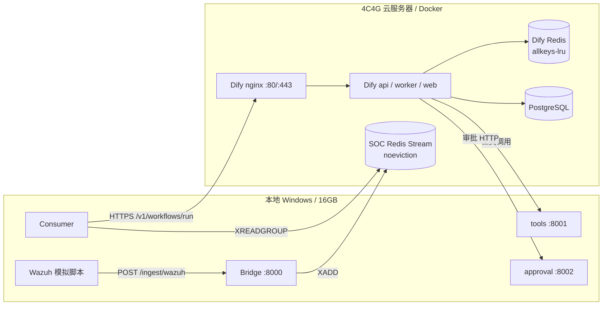

# 4C4G 云端 Dify + Redis 部署与联调指南

> 适用环境：Dify 1.16.x / 1.17.x、Docker Compose v2、4 核 4GB Linux 云服务器；本地 Windows 16GB 运行 Bridge、tools、approval、consumer、Wazuh 模拟脚本和 VS Code。1.17 的 schema 与运行差异见第 9 节。
>
> 本文是部署与排错清单。首次部署请按“冒烟测试”逐段验证；真实环境中的 Dify 版本、compose 文件命名和服务名可能略有差异。

## 0. 先记住 5 个结论

1. **3GB 是 Dify 整栈预算，不是给 `api` 一个容器 3GB。** 4GB 机器给每个核心服务 3GB 会直接 OOM。
2. **Dify 缓存 Redis 可以用 `allkeys-lru`；SOC 告警 Stream Redis 绝对不能用 `allkeys-lru`。** 前者丢缓存可重建，后者丢的是告警。
3. **容器里的 `127.0.0.1` 是容器自己，不是宿主机。** Dify 调宿主机工具必须用 `host.docker.internal`、宿主机内网 IP 或隧道域名。
4. **`host.docker.internal` 在 Linux 上默认不一定能解析。** 需要在 compose 里加 `extra_hosts: host-gateway`。
5. **Redis 6379 不要对公网开放。** 本地开发机通过 SSH 隧道、Tailscale/WireGuard 或云厂商私网访问。

---

## 1. 推荐拓扑与依赖方向

### 1.1 两种可用拓扑

| 方案 | 云端运行 | 本地运行 | 适用场景 |
| --- | --- | --- | --- |
| A. 轻量本地开发（推荐先跑通） | Dify 全家桶 + SOC Redis Stream | Bridge、tools、approval、consumer、Wazuh 模拟 | 本地 16GB 跑工具服务，云端只承担 Dify 和队列 |
| B. 云端一体化 | Dify + SOC Redis + Bridge + tools + approval + consumer | 浏览器、VS Code、Wazuh 模拟脚本 | 希望减少隧道；但 4C4G 余量更紧，Wazuh Indexer 不能同机 |

本项目不建议把 **Wazuh Indexer（OpenSearch/JVM）** 和 Dify 挤在同一台 4C4G 机器上。Wazuh Indexer 应使用已有集群或独立机器；本地演示可以用 `WAZUH_MODE=mock`。

### 1.2 调用关系



> 图中 Dify 调本地 tools/approval 的线，实际需要 HTTPS 隧道或同一内网；不能写 `127.0.0.1`。

### 1.3 谁访问谁

| 调用方 | 目标 | 正确地址示例 | 说明 |
| --- | --- | --- | --- |
| Dify api/worker | tools | `http://host.docker.internal:8001` | tools 在同一台云主机 |
| Dify api/worker | tools（本地电脑） | `https://soc-tools.example.com` | 通过 Cloudflare Tunnel/Tailscale/frp |
| Dify api/worker | approval | `http://host.docker.internal:8002/approvals` | approval 在同一台云主机 |
| Dify api/worker | approval（本地电脑） | `https://soc-approval.example.com/approvals` | 不能用 `host.docker.internal` |
| tools | Wazuh Indexer | `https://wazuh.example.internal:9200` | 建议走内网/VPN |
| 本地 consumer | Dify API | `https://dify.example.com/v1` | 经 nginx 443；不要直连 api 容器 5001 |
| 本地 bridge/consumer | SOC Redis | `redis://127.0.0.1:6379/0` | 经 SSH 隧道；云端只监听 127.0.0.1 |
| Wazuh/模拟器 | Bridge | `http://<云端IP>:8000/ingest/wazuh` | 仅放行 Wazuh 来源 IP，并带 `BRIDGE_TOKEN` |
| Dify 内部 | PostgreSQL/Redis/Weaviate | `db:5432`、`redis:6379`、`weaviate:8080` | compose 服务名，不能用 `127.0.0.1` |

---

## 2. 4C4G Docker Compose Override

文件：`deploy/dify-cloud-4c4g.override.yml`

### 2.1 为什么不是 `api: mem_limit: 3g`

```
4GB 总内存
├─ Dify api       700MB
├─ Dify worker    512MB
├─ Dify web       128MB
├─ PostgreSQL     384MB
├─ Dify Redis     320MB 容器上限 / 256MB 逻辑上限
├─ Weaviate       512MB
├─ sandbox        128MB
├─ plugin_daemon  256MB
├─ ssrf_proxy      64MB
└─ nginx           64MB
   合计约 3.0GB，余下约 1GB 给宿主机
```

如果给 `api`、`worker`、`web` 各 3GB，单个服务就能吃满整台机器。正确做法是**整栈设预算，再按服务细化**。

### 2.2 完整 override

```yaml
# Dify 1.16.x / 4C4G 云服务器内存 override
#
# 用法（在 Dify 官方 compose 目录执行）：
#   cp /opt/soc-agent-l1/deploy/dify-cloud-4c4g.override.yml .
#   docker compose -f docker-compose.yaml -f dify-cloud-4c4g.override.yml config
#   docker compose -f docker-compose.yaml -f dify-cloud-4c4g.override.yml up -d
#
# 重要：
# - 这里的 3GB 是“Dify 整栈预算”，不是给 api 单个容器 3GB。
# - mem_limit 与 memswap_limit 相同，禁止用 swap 掩盖内存超卖。
# - 如果 Dify 使用 pgvector 而不是 weaviate，删除 weaviate 段，
#   并把释放出的内存分给 db 或 api，不要保留不存在的 service。
# - Dify 缓存 Redis 可以淘汰；本项目 SOC Stream Redis 是另一个实例，
#   必须使用 noeviction（见 docs/CLOUD_DEPLOY.md）。

services:
  api:
    mem_limit: 700m
    memswap_limit: 700m
    mem_swappiness: 0
    extra_hosts:
      - "host.docker.internal:host-gateway"

  worker:
    mem_limit: 512m
    memswap_limit: 512m
    mem_swappiness: 0
    extra_hosts:
      - "host.docker.internal:host-gateway"

  web:
    mem_limit: 128m
    memswap_limit: 128m
    mem_swappiness: 0

  db:
    mem_limit: 384m
    memswap_limit: 384m
    mem_swappiness: 0

  # Dify 内部缓存 / Celery broker Redis。
  # 320m 是容器硬上限，256mb 是 Redis 逻辑内存上限。
  redis:
    mem_limit: 320m
    memswap_limit: 320m
    mem_swappiness: 0
    command:
      - redis-server
      - --appendonly
      - "yes"
      - --maxmemory
      - 256mb
      - --maxmemory-policy
      - allkeys-lru

  # Dify 默认向量库；使用 pgvector 时删除此服务。
  weaviate:
    mem_limit: 512m
    memswap_limit: 512m
    mem_swappiness: 0

  sandbox:
    mem_limit: 128m
    memswap_limit: 128m
    mem_swappiness: 0

  plugin_daemon:
    mem_limit: 256m
    memswap_limit: 256m
    mem_swappiness: 0

  ssrf_proxy:
    mem_limit: 64m
    memswap_limit: 64m
    mem_swappiness: 0
    extra_hosts:
      - "host.docker.internal:host-gateway"

  nginx:
    mem_limit: 64m
    memswap_limit: 64m
    mem_swappiness: 0
```

### 2.3 使用与校验

> **不要直接把本文件放到本项目 `deploy/` 目录并命名为 `docker-compose.override.yml`。** 这样 Docker Compose 会自动把它和 `deploy/docker-compose.yml`（SOC 服务）合并，造成服务名冲突。请按下面的方式放到 **Dify 自己的 compose 目录**，或显式使用 `-f`。

```bash
# 1. 进入 Dify 官方 compose 目录
cd /opt/dify/docker

# 2. 复制 override，和官方 compose 放在同一目录
cp /opt/soc-agent-l1/deploy/dify-cloud-4c4g.override.yml .

# 3. 先做配置解析，确认没有未知 service / YAML 错误
docker compose -f docker-compose.yaml -f dify-cloud-4c4g.override.yml config >/tmp/dify-compose.out

# 4. 启动
docker compose -f docker-compose.yaml -f dify-cloud-4c4g.override.yml up -d

# 5. 观察内存，不要只看单容器
docker stats --no-stream
```

如果官方文件名是 `docker-compose.yml`，把命令里的 `docker-compose.yaml` 换成实际文件名。

### 2.4 内存设置的两个关键细节

- `mem_limit` 是单个容器的硬上限；**不是预留**。真正总占用仍要看 `docker stats`。
- `memswap_limit` 与 `mem_limit` 相同，容器无法通过 swap 超额使用内存；这样 OOM 更早暴露，不会拖垮整机。
- `redis` 容器 320m、Redis `maxmemory 256mb`：给 Redis 自身数据结构、连接和 allocator 留约 64m 余量。
- **Dify 的 Redis 也可能承担 Celery broker。** `allkeys-lru` 在内存压力下可能淘汰排队任务；如果任务丢失不可接受，应把 broker 拆到独立 Redis 实例/DB，或对该实例使用 `noeviction`，再单独限制缓存。4C4G MVP 先按 `allkeys-lru` 控制内存，但上线前要用 `docker stats` 观察是否真的触发淘汰。
- 如果 Dify 版本使用 `pgvector` 而不是 `weaviate`，删除 `weaviate` 段，把 512m 中的一部分分给 `db` 或 `api`，总预算仍控制在 3GB 左右。
- 如果 `plugin_daemon` 启动 DeepSeek 插件后频繁 OOM，优先降低 `worker` 或 `weaviate`，不要直接把 `api` 提到 3GB。

---

## 3. Docker 访问宿主机/外部服务

### 3.1 四条硬规则

1. **容器内 `127.0.0.1` = 容器自己。** Dify 里配置 `http://127.0.0.1:8001` 一定访问不到宿主机的 tools。
2. **`localhost` 同理。** 不要因为浏览器里能打开就填 `localhost`。
3. **同一 compose 网络的另一个服务用服务名。** 例如 Dify 内部访问数据库用 `db:5432`，不是 `127.0.0.1:5432`。
4. **Dify 在云端、tools 在本地电脑时，`host.docker.internal` 指向云服务器，不是你的笔记本。** 必须使用隧道/内网地址。

### 3.2 `host.docker.internal` 的正确用法

Docker Desktop（Windows/macOS）通常自动支持 `host.docker.internal`。Linux Docker 默认不支持，需要在 Dify 的 `api` 和 `worker` 服务加：

```yaml
services:
  api:
    extra_hosts:
      - "host.docker.internal:host-gateway"
  worker:
    extra_hosts:
      - "host.docker.internal:host-gateway"
```

本项目的 `deploy/dify-cloud-4c4g.override.yml` 已经包含这两段。Docker Engine 20.10+ 支持 `host-gateway`。

验证：

```bash
# 确认容器能解析
docker compose exec api getent hosts host.docker.internal

# 确认容器能访问宿主机 tools
docker compose exec api python -c \
  "import urllib.request; print(urllib.request.urlopen('http://host.docker.internal:8001/health', timeout=3).read().decode())"
```

如果 `host-gateway` 不可用，查宿主机的 Docker 网桥地址：

```bash
ip -4 addr show docker0
# 或
docker network inspect <dify_default_network> | grep -i gateway
```

不要把 `172.17.0.1` 当成永远正确的地址：Dify 使用自定义 bridge 网络时，网关可能是 `172.18.0.1`、`172.19.0.1`。用实际网关或宿主机内网 IP。

> Dify 的 HTTP 请求/代码节点可能经过 `ssrf_proxy`。如果 `api` 容器能访问 tools，但工作流里的工具/审批仍然超时，给 `ssrf_proxy` 也加同样的 `extra_hosts`，并检查代理是否允许该内部地址；不要把“关闭 SSRF 防护”当作长期方案。

### 3.3 tools 在云服务器宿主机

如果 tools 和 Dify 在同一台云服务器，但 tools 不在 Dify compose 内：

```bash
# 在云服务器宿主机启动 tools，监听所有网卡或指定私网 IP
python -m soc_agent serve tools --host 0.0.0.0 --port 8001
```

Dify 自定义工具的 Server URL：

```text
http://host.docker.internal:8001
```

如果只想绑定私网：

```bash
python -m soc_agent serve tools --host 172.16.0.10 --port 8001
```

Dify 填 `http://172.16.0.10:8001`，安全组只允许 Dify 所在主机私网 IP。

### 3.4 tools 在本地电脑：必须用隧道

Dify 云端容器里的 `host.docker.internal` 指向云服务器，而不是你的笔记本。可选方案：

| 方案 | Dify 工具 URL | 说明 |
| --- | --- | --- |
| Cloudflare Tunnel | `https://soc-tools.example.com` | 有正式域名和 TLS，适合演示 |
| Tailscale | `http://100.x.y.z:8001` | 云端和本地加入同一 tailnet；注意容器路由 |
| frp/ngrok | `https://xxxx.ngrok-free.app` | 临时联调；免费域名可能变化 |
| 公网 IP + 端口 | `http://<家庭公网IP>:8001` | 不推荐；NAT、动态 IP、暴露面都麻烦 |

Cloudflare Tunnel 快速示例（仅本地临时验证）：

```powershell
# 本地 PowerShell：把 8001 暴露为临时 HTTPS 地址
cloudflared tunnel --url http://127.0.0.1:8001
```

把输出的 `https://...trycloudflare.com` 填到 Dify 工具 Server URL。正式环境请用命名隧道 + 自有域名，不要依赖随机临时域名。

> Dify 导入 OpenAPI 时，`servers.url` 里原来的 `host.docker.internal` 只是模板；导入后必须在工具编辑页改成实际隧道 URL。

### 3.5 approval 在本地电脑

Dify 工作流的审批 HTTP 节点默认是：

```text
http://host.docker.internal:8002/approvals
```

如果 approval 在本地电脑，这个地址会让云端 Dify 访问云服务器自己，导致连接失败。改成隧道地址，例如：

```text
https://soc-approval.example.com/approvals
```

同时确认：

- Dify HTTP 节点的 `headers` 中包含 `Authorization: Bearer <APPROVAL_API_TOKEN>`；
- `APPROVAL_PUBLIC_URL` 是审批人浏览器能打开的 HTTPS 地址；
- `APPROVAL_EXPOSE_LINKS=false` 时，不要把裸 `8002` 暴露到公网；
- 审批链接和 API 鉴权使用 `APPROVAL_API_TOKEN`，不要只靠“URL 猜不到”。

### 3.6 Redis Stream：Dify Redis 与 SOC Redis 必须分开

| Redis | 用途 | maxmemory | 淘汰策略 | 端口暴露 |
| --- | --- | --- | --- | --- |
| Dify compose 的 `redis` | Dify 缓存 / Celery broker | 256MB | `allkeys-lru` | 仅 compose 内部 |
| 本项目 SOC Redis | `wazuh:alerts` Stream 队列 | 256MB | **`noeviction`** | 仅 `127.0.0.1` + SSH 隧道 |

**不要把 SOC Stream Redis 配成 `allkeys-lru`。** Stream 条目被淘汰后，告警会直接丢失，消费者无法重放。`deploy/docker-compose.yml` 已经使用：

```yaml
command:
  - redis-server
  - --appendonly
  - "yes"
  - --maxmemory
  - 256mb
  - --maxmemory-policy
  - noeviction
ports:
  - "127.0.0.1:6379:6379"
```

如果 SOC Redis 在云服务器宿主机，本地开发机通过 SSH 隧道访问：

```bash
# 本地终端保持这个连接
ssh -N -L 6379:127.0.0.1:6379 deploy@<云端IP>
```

本地 `.env`：

```dotenv
SOC_QUEUE_MODE=redis
REDIS_URL=redis://127.0.0.1:6379/0
```

这样云端 6379 仍然只监听 loopback，安全组不需要放行 6379。若使用 Tailscale/WireGuard，可把 Redis 绑定到 VPN 地址，并把安全组限制到 VPN 网段。

如果必须公网直连 Redis（不推荐），至少同时做到：

- Redis `requirepass` 或 ACL 强密码；
- TLS（stunnel/Redis TLS）或 SSH 隧道；
- 安全组只允许固定公网 IP `/32`；
- 禁用 `FLUSHALL`、`CONFIG` 等危险命令；
- 绝不使用 `0.0.0.0/0` 放行 6379。

**如果 SOC Redis 跑在本地电脑：**

- 本地 Bridge 和 consumer 都写 `redis://127.0.0.1:6379/0`；
- Dify **不需要**连接这个 Redis，不要为了“让 Dify 看到”而把本地 6379 暴露到公网；
- 如果 consumer 在云端而 Redis 在本地，才需要反向隧道/私网；更推荐把 Redis 放在云端，避免本机断网导致告警积压丢失。

### 3.7 Dify 不直接访问 Wazuh、SOC Redis 或 Bridge

Dify 只通过 **tools/approval HTTP API** 与外部交互：

- Wazuh 告警由 Bridge 写入 SOC Redis，由 consumer 消费后再调用 Dify；
- Dify 不直接读 `wazuh:alerts` Stream；
- Dify 不直接访问 Wazuh Indexer，只有 tools 服务会查 Wazuh；
- Dify 不调用 Wazuh Webhook，Webhook 是 Wazuh → Bridge 的方向。

因此不要把 Dify 的 Redis 配置指向 SOC Stream Redis，也不要把 SOC Redis 的地址填进 Dify 的模型/工具 URL。

### 3.8 Bridge/Wazuh Webhook 的方向

Dify **不会主动调用** Wazuh Webhook。真实方向是：

```text
Wazuh integratord / 模拟脚本
    -> POST http://<bridge>:8000/ingest/wazuh
    -> Bridge XADD 到 SOC Redis
    -> Consumer XREADGROUP 并调用 Dify
```

因此：

- Bridge 在本地：模拟脚本直接 POST `http://127.0.0.1:8000`，不需要 Dify 访问它；
- Bridge 在云端：模拟脚本 POST `http://<云端IP>:8000`，安全组只放行本地公网 IP，并设置 `BRIDGE_TOKEN`；
- 不要把 8000 和 6379 一起无差别暴露；Bridge 至少要有 token 和来源 IP 限制。

---

## 4. Dify UI 手动绑定两个工具

### 4.1 前置检查

在 Dify UI 操作前，先确认：

```bash
# 宿主机 tools 健康
curl -fsS http://127.0.0.1:8001/health

# Dify 容器到 tools 健康（tools 在宿主机时）
docker compose exec api python -c \
  "import urllib.request; print(urllib.request.urlopen('http://host.docker.internal:8001/health', timeout=3).read().decode())"
```

如果第二条失败，先解决网络，不要在 UI 里反复点“测试”，否则只会得到连接超时。

同时确认 Dify 工作区已安装：

- `langgenius/agent`（Agent 策略插件）
- `langgenius/deepseek`（DeepSeek 模型插件）

导入 `dify/l1-triage.workflow.yml` 后，Agent 节点的模型选择 `deepseek-flash`；如果当前插件版本只显示 `deepseek-chat` 等模型，在 UI 改选实际可用的聊天模型。不要删除 DSL 顶部的 `dependencies`。

### 4.2 创建 `fetch_wazuh_alerts`

以 Dify 1.16 中文界面为例（英文界面菜单名在括号中）：

1. 顶部导航进入 **工具（Tools）**；
2. 选择 **自定义（Custom）**；
3. 点击 **创建自定义工具（Create Custom Tool）**；
4. 选择 **从 OpenAPI 导入（Import from OpenAPI）**；
5. 粘贴 `dify/tools/fetch_wazuh_alerts.openapi.yaml` 的完整内容；
   - 如果 UI 只接受 URL，必须把 YAML 放到 Dify 能访问的 HTTPS 地址，不能填本地 `E:\...` 路径；
   - 也可以把 YAML 提交到私有 Gist/静态文件服务，但要确认没有把 token 写进文件；
6. 工具名称/Operation 保持 `fetch_wazuh_alerts`，不要改成中文别名；
7. Server URL 填实际地址：
   - tools 与 Dify 同机：`http://host.docker.internal:8001`
   - tools 在本地经隧道：`https://soc-tools.example.com`
   - tools 和 Dify 同一 compose 网络：`http://tools:8001`
8. 认证方式选 **API Key / Bearer**：
   - Header 名称：`Authorization`
   - Value：`Bearer <TOOL_API_TOKEN>`
   - 如果 Dify 的认证类型已经自动加 `Bearer ` 前缀，则只填 token，避免出现 `Bearer Bearer ...`；
9. 保存后进入工具的调试/测试页，发送：

```json
{
  "limit": 5,
  "min_level": 5,
  "src_ip": "203.0.113.45"
}
```

期望返回 `ok: true`。如果返回 401，检查 `TOOL_API_TOKEN` 与 Dify 认证头；返回 422，检查请求体是否严格匹配 OpenAPI。

### 4.3 创建 `search_attack_knowledge`

重复上述步骤，导入：

```text
dify/tools/search_attack_knowledge.openapi.yaml
```

Operation 保持：

```text
search_attack_knowledge
```

测试请求：

```json
{
  "query": "T1110 ssh brute force",
  "top_k": 3
}
```

期望返回 `ok: true`，并且 `data.results` 中有 ATT&CK 或 IOC 结果。

### 4.4 在 Agent 节点重新勾选

DSL 导入后 Agent 节点工具列表是空的，这是故意的：自定义工具的 `provider_id` 是工作区级 ID，不能跨工作区移植。

操作路径：

1. 进入 **工作室（Studio）**，打开「SOC L1 告警分诊」；
2. 点击 **Agent 节点**；
3. 右侧配置面板找到 **工具（Tools）**；
4. 点击 **添加工具（Add Tool）** 或 **+**；
5. 在自定义工具列表中勾选：
   - `fetch_wazuh_alerts`
   - `search_attack_knowledge`
6. 确认 Agent 节点显示两个工具，而不是仍为空；
7. 确认 `maximum_iterations` 为 `3`，且系统指令中仍有“最多 3 次工具调用”；
8. 保存并 **发布（Publish）**。

如果工具列表看不到自定义工具：

- 确认当前工作区就是创建工具的工作区；
- 刷新页面；
- 确认工具已保存且测试通过；
- 确认 Dify 的 Agent 插件已安装；
- 检查工具是否被禁用或认证配置错误。

### 4.5 发布并创建 API Key

1. 右上角 **发布**；
2. 进入 **访问 API（API Access）**；
3. 创建应用 API Key，形如 `<YOUR_API_KEY>`；
4. 写入本地 `.env`：

```dotenv
DIFY_MODE=api
DIFY_API_BASE=https://dify.example.com/v1
DIFY_API_KEY=<YOUR_API_KEY>
```

注意：

- 应用 API Key 不是知识库 Dataset API Key；
- `DIFY_API_BASE` 走 nginx 的 80/443，不要填容器内 `api:5001`；
- 如果 Dify 只开 HTTP，联调阶段可以用 `http://<云端IP>/v1`，正式环境建议 HTTPS。

### 4.6 冒烟测试

在 Dify 工作流运行面板输入：

```json
{
  "alert_json": "{\"id\":\"wazuh-1001\",\"rule\":{\"level\":12,\"description\":\"sshd: brute force\",\"mitre\":{\"id\":[\"T1110\"]}},\"agent\":{\"name\":\"web-01\"},\"data\":{\"srcip\":\"203.0.113.45\"},\"full_log\":\"Failed password for root\"}",
  "trace_id": "trc_smoke_0001"
}
```

期望：

- `decision=escalate`；
- 输出标准四字段：`decision/confidence/reason/evidence`；
- evidence 中有 `policy` 的 `block_ip`，且 `destructive=true`、`requires_approval=true`；
- 审批服务可达时返回 `approval_id`；
- 工具调用次数不超过 3。

---

## 5. 安全组、防火墙与密钥

### 5.1 端口暴露矩阵

| 端口 | 服务 | 建议来源 | 是否对公网 |
| --- | --- | --- | --- |
| 22 | SSH | 管理员固定 IP `/32` | 仅管理 IP |
| 80/443 | Dify nginx / Web UI / API | 需要访问 Dify 的用户或 `0.0.0.0/0` | 是，建议 443 + TLS |
| 6379 | Dify 内部 Redis | 仅 compose 内部 | 否 |
| 6379 | SOC Redis Stream | 本地开发机经 SSH 隧道/VPN | 否 |
| 5432 | PostgreSQL | 仅 compose 内部 | 否 |
| 8080 | Weaviate | 仅 compose 内部 | 否 |
| 5001 | Dify api 容器 | 仅本机/内网调试 | 否 |
| 8000 | Bridge | Wazuh/模拟器来源 IP | 尽量隧道，必要时限制 IP |
| 8001 | tools | Dify 所在主机或隧道 | 否 |
| 8002 | approval API | Dify 所在主机或隧道 | 否 |
| 443 | 审批链接 | 审批人 | 是，经反向代理 |

### 5.2 云安全组示例

入方向：

```text
22/tcp      <管理员公网IP>/32
80/tcp      0.0.0.0/0
443/tcp     0.0.0.0/0
8000/tcp    <本地/办公公网IP>/32     # 仅当 Bridge 在云端且模拟器远程推送
```

**不要添加：**

```text
6379/tcp    0.0.0.0/0     # 绝对禁止
5432/tcp    0.0.0.0/0
8001/tcp    0.0.0.0/0
8002/tcp    0.0.0.0/0
5001/tcp    0.0.0.0/0
```

如果 Dify 和 tools 在不同机器，只允许 Dify 主机的私网 IP 访问 8001/8002；如果走隧道，不需要放行 8001/8002。

### 5.3 UFW 与 Docker 的坑

Ubuntu 上可以启用 UFW：

```bash
sudo ufw default deny incoming
sudo ufw default allow outgoing
sudo ufw allow 22/tcp
sudo ufw allow 80/tcp
sudo ufw allow 443/tcp
sudo ufw enable
sudo ufw status verbose
```

**注意：Docker 的 `-p` 端口映射可能绕过 UFW 的 INPUT 规则。** 安全组是第一道防线，但还要：

- 尽量把管理端口绑定到 `127.0.0.1`，例如 Redis：
  ```yaml
  ports:
    - "127.0.0.1:6379:6379"
  ```
- 用 `docker ps` 检查是否出现 `0.0.0.0:6379->6379/tcp`；
- 必要时在 `DOCKER-USER` 链限制 Docker 发布端口：

```bash
# 示例：拒绝从公网网卡进入 6379；具体网卡名用 ip addr 确认
sudo iptables -I DOCKER-USER -i eth0 -p tcp --dport 6379 -j DROP
sudo iptables -I DOCKER-USER -i eth0 -p tcp --dport 8000 -j DROP
```

规则要按实际网卡、来源 IP 调整；改完后用外部端口扫描确认。

本地 Windows 也要注意：Cloudflare Tunnel/Tailscale 是**出站连接**，不需要在 Windows 防火墙上给 8001/8002 开公网入站。只有在同一局域网直接访问 tools/approval 时，才添加仅允许对应私网网段的入站规则。

### 5.4 Redis 安全

- SOC Redis 默认只监听 `127.0.0.1`；
- 本地通过 SSH 隧道访问，不把 6379 写进安全组；
- 如使用 Tailscale/WireGuard，把 Redis 绑定到 VPN 地址，安全组限制 VPN 网段；
- 如必须公网访问，启用 Redis ACL/密码 + TLS，并只允许固定 IP；
- 不要把 Redis 密码写进 Git、README 或 Dify 工具 schema；
- Stream 队列使用 `noeviction`，避免告警被静默淘汰。

### 5.5 应用密钥

```bash
openssl rand -hex 32   # TOOL_API_TOKEN
openssl rand -hex 32   # APPROVAL_API_TOKEN
openssl rand -hex 32   # BRIDGE_TOKEN
```

- `.env` 权限设为 `600`，不要提交；
- Dify 的 `SECRET_KEY` 不要使用默认值；
- Dify API Key 只放在本地 `.env` 或密钥管理，不放进 Wazuh 脚本；
- Wazuh 只持有 `BRIDGE_TOKEN`，不持有 Dify/DeepSeek Key；
- 审批链接使用 `APPROVAL_PUBLIC_URL`，不要把 8002 裸端口公开。

---

## 6. 从零联调顺序

### 6.1 云端启动 Dify

```bash
cd /opt/dify/docker
cp /opt/soc-agent-l1/deploy/dify-cloud-4c4g.override.yml .
docker compose -f docker-compose.yaml -f dify-cloud-4c4g.override.yml config >/tmp/dify-compose.out
docker compose -f docker-compose.yaml -f dify-cloud-4c4g.override.yml up -d
docker compose ps
docker stats --no-stream
```

打开 `http://<云端IP>/` 或 `https://dify.example.com/`，完成管理员初始化。

### 6.2 云端启动 SOC Redis

```bash
cd /opt/soc-agent-l1
docker compose -f deploy/docker-compose.yml up -d redis
docker compose -f deploy/docker-compose.yml ps redis
```

确认只绑定 loopback：

```bash
docker ps --format '{{.Names}}\t{{.Ports}}' | grep redis
# 期望看到 127.0.0.1:6379->6379/tcp，而不是 0.0.0.0:6379
```

### 6.3 本地建立 Redis 隧道

```powershell
ssh -N -L 6379:127.0.0.1:6379 deploy@<云端IP>
```

另开终端验证：

```powershell
redis-cli -h 127.0.0.1 -p 6379 ping
# PONG
```

### 6.4 本地启动 tools / approval / bridge

```powershell
# 终端 1
python -m soc_agent serve tools --host 0.0.0.0 --port 8001

# 终端 2
python -m soc_agent serve approval --host 0.0.0.0 --port 8002

# 终端 3
python -m soc_agent serve bridge --host 0.0.0.0 --port 8000
```

如果只在本机模拟 Wazuh，绑定 `127.0.0.1` 更安全；只有云端 Dify 或远程 Wazuh 需要访问时，才绑定 `0.0.0.0` 并加隧道/防火墙。

本地健康检查：

```powershell
curl http://127.0.0.1:8001/health
curl http://127.0.0.1:8002/health
curl http://127.0.0.1:8000/health
```

通过 Cloudflare Tunnel/frp 暴露 tools/approval 后，在 Dify 容器里验证：

```bash
docker compose exec api python -c \
  "import urllib.request; print(urllib.request.urlopen('https://soc-tools.example.com/health', timeout=5).read().decode())"
```

### 6.5 导入 DSL、创建工具、绑定 Agent

按第 4 节完成：

1. 安装 `langgenius/agent`、`langgenius/deepseek` 插件；
2. 导入 `dify/l1-triage.workflow.yml`；
3. 创建两个自定义工具；
4. 在 Agent 节点勾选两个工具；
5. 发布并创建 `<YOUR_API_KEY>` API Key。

> DSL 导入后工具为空是正常现象，必须手动绑定；不要误以为 DSL 漏写。

### 6.6 本地 consumer 连接云端 Dify

本地 `.env` 至少：

```dotenv
SOC_QUEUE_MODE=redis
REDIS_URL=redis://127.0.0.1:6379/0

DIFY_MODE=api
DIFY_API_BASE=https://dify.example.com/v1
DIFY_API_KEY=<YOUR_API_KEY>

TOOL_API_TOKEN=<与 Dify 工具认证一致>
APPROVAL_API_TOKEN=<与 Dify HTTP 节点一致>
BRIDGE_TOKEN=<与 Wazuh/模拟器一致>
```

启动：

```powershell
python -m soc_agent consume
```

### 6.7 端到端验证

1. 用任务 3 的 `scripts/simulate_wazuh.py` 向 Bridge 推送 5 条模拟告警；
2. 观察 Bridge 返回 `202`；
3. 观察 consumer 从 Redis Stream 读取并调用 Dify；
4. 在 Dify 运行记录确认工具调用和标准四字段输出；
5. 本地查询 Trace，确认 `decision`、`evidence`、`approval_id` 可重建；
6. 若为 `escalate`，确认审批请求被创建，审批通过后状态变更；
7. 确认 `docker stats` 总内存没有持续逼近 4GB。

---

## 7. 常见故障排查

| 现象 | 高概率原因 | 处理 |
| --- | --- | --- |
| 容器 exit 137 / Dify 502 | 内存 OOM | `docker stats`、`docker inspect -f '{{.State.OOMKilled}}'`、`dmesg`；下调 worker/weaviate，或加 swap 仅作缓冲 |
| Dify 工具连接超时 | 填了 `127.0.0.1` | 改 `host.docker.internal`、宿主机私网 IP 或隧道 URL |
| `host.docker.internal` 解析失败 | Linux Docker 未配置 | 加 `extra_hosts: host-gateway`，重建容器 |
| Dify 能访问宿主机但 tools 拒绝 | tools 只监听 `127.0.0.1` | tools 改监听 `0.0.0.0` 或私网 IP，并限制来源 |
| 工具测试 401 | token 不一致/重复 Bearer | 对齐 `TOOL_API_TOKEN`；检查 `Bearer Bearer` |
| 工具测试 422 | 请求体不符合 OpenAPI | 用文档里的最小请求体；检查 `additionalProperties: false` |
| Dify Agent 没有工具 | 没手动绑定 | Agent 节点 → 工具 → 添加两个自定义工具 |
| 自定义工具不可见 | workspace/provider 不匹配 | 在同一工作区重建；刷新页面；确认保存成功 |
| Redis 连接超时 | 隧道没开/安全组阻断 | 检查 SSH `-L`、云端 `127.0.0.1:6379`、`redis-cli ping` |
| Redis `NOAUTH` | 设置了密码但 URL 没带 | 使用 `redis://:password@host:6379/0` 或 ACL URL |
| Stream 消息丢失 | 用了 `allkeys-lru` | SOC Redis 改 `noeviction`；与 Dify 缓存 Redis 分开 |
| 审批链接打不开 | `APPROVAL_PUBLIC_URL` 是 localhost | 改公网 HTTPS 地址；或将 `APPROVAL_EXPOSE_LINKS=false` |
| Dify 工作流审批失败 | 审批节点仍指向 `host.docker.internal`，但 approval 在本地 | 改隧道 HTTPS URL；容器内 host 不是你的笔记本 |
| Dify API 401 | 用了 Dataset Key 或未发布 | 用应用 API Key；先 Publish 再创建 Key |
| `docker compose config` 报 unknown service | Dify 版本使用 pgvector/其它服务名 | 删除不存在的 override 段，按实际 compose 服务名调整 |

### 7.1 OOM 快速定位

```bash
docker stats --no-stream
docker inspect -f '{{.Name}} OOMKilled={{.State.OOMKilled}} Exit={{.State.ExitCode}}' $(docker ps -aq)
sudo dmesg -T | grep -i -E 'oom|killed process'
```

如果总 RSS 持续超过 3GB：

1. 先确认是否安装了不必要插件；
2. 降低 `worker` 并发（如 Dify 版本支持 `CELERY_WORKER_AMOUNT=1`）；
3. 删除不用的 `weaviate`，改用 pgvector；
4. 不要把 Wazuh Indexer 放到同一台 4C4G 机器；
5. 临时加 2GB swap 只用于避免瞬时 OOM，不能当作容量规划。

---

## 8. 上线验收清单

- [ ] `docker compose config` 无错误，override 只包含实际存在的 service。
- [ ] `docker stats` 显示 Dify 整栈约 3GB，未持续逼近 4GB。
- [ ] Dify Web UI 可登录，80/443 正常，5001/5432/6379/8080 未对公网开放。
- [ ] Dify 容器能解析并访问 `host.docker.internal:8001`（或隧道 URL）。
- [ ] `fetch_wazuh_alerts`、`search_attack_knowledge` 创建成功，调试返回 `ok: true`。
- [ ] Agent 节点已勾选两个工具，`maximum_iterations=3`。
- [ ] Dify 工作流输出标准四字段：`decision/confidence/reason/evidence`。
- [ ] `escalate` 会生成 `policy` evidence，审批节点能创建 `approval_id`。
- [ ] SOC Redis 使用 `noeviction`，只监听 `127.0.0.1` 或 VPN 地址。
- [ ] 本地通过 SSH 隧道/VPN 能 `PING` 云端 Redis，公网扫描 6379 关闭。
- [ ] Bridge 有 `BRIDGE_TOKEN`，来源 IP 受安全组限制。
- [ ] `TOOL_API_TOKEN`、`APPROVAL_API_TOKEN`、Dify API Key 不进入 Git。
- [ ] 审批链接使用 HTTPS 公网地址，8002 未直接暴露。
- [ ] 端到端跑通 5 条模拟告警，Trace 可重建决策链。
- [ ] `SSRF_PROXY_ALLOW_PRIVATE_IPS` 只放行 Dify 实际需要的宿主网段（如 `172.17.0.0/16`），未放行 `0.0.0.0/0`。
- [ ] `approval_parse` 节点生效：`escalate` 告警 end 输出真实 `approval_id`，同一告警不出现双审批。

---

## 9. Dify 1.17.x 兼容踩坑记录（实测 1.17.1）

> 本章记录 `dify/l1-triage.workflow.yml` 与 SOC 服务在 Dify 1.17.1 联调时踩到的 schema/运行差异。本地 DSL 已包含全部修复；导入 1.17 后仍需按第 4 节重新绑定工具、按 9.5 配置模型凭证。

### 9.1 DSL 节点 schema 差异

| 位置 | 1.16 写法（1.17 导入后运行报错） | 1.17 正确写法 |
| --- | --- | --- |
| HTTP 节点 `params` | `params: []` | `params: ""`（pydantic 严格校验字符串） |
| HTTP 节点 `timeout` | `max_connect_timeout` / `max_read_timeout` / `max_write_timeout` | `connect` / `read` / `write`（旧字段被静默忽略） |
| 所有节点 `error_strategy` | `continue`（枚举已删除） | `default-value` 或 `fail-branch` |
| Agent `model.value` | 只有 `provider/model/mode` | 必须补 `model_type: llm`，否则报 `'' is not a valid ModelType` |
| Agent 输出引用 | `[agent, output]` | `[agent, text]`（Function Calling 策略的输出变量名是 `text`；引用 `output` 得到空串，validate 里 `json.loads("")` 报 `Expecting value: line 1 column 1 (char 0)`） |

排查技巧：不必反复导 UI，可在 api 容器里对 code 节点跑 `compile()`；graph 节点也可直接用 `graphon` 的 `NodeConfigDictAdapter` 校验，报错会精确到字段。

### 9.2 HTTP 节点的 JSON body：恰好一项 + 字符串要双重转义

1.17 要求 `type: json` 的 body **恰好一项**，`value` 是模板字符串（`{{#node.field#}}` 文本展开，展开后 `json_repair` + `json.loads`）。多项目写法会报：

```text
RequestBodyError: json body type should have exactly one item
```

`result_json` 这类"本身是 JSON 文本"的字符串字段，模板展开不会转义引号。修复：validate 节点多输出一个 `result_json_escaped = json.dumps(result_json)`，body 模板中写 `"result_json": {{#validate.result_json_escaped#}}`（escaped 自带外层引号，**不要再加引号**）。

### 9.3 HTTP 响应 `body` 是字符串：审批去重需要 code 节点

`[approval, body, approval_id]` 三段选择器无效——`body` 是响应文本（字符串）而不是 dict，取子字段得到 `null`，导致 consumer 兜底再建一条审批（同一告警产生双审批）。

修复：加 code 节点 `approval_parse`（inputs `[approval, body]`，输出 `approval_id: string`）：

```python
"""从审批服务的 HTTP 响应体中提取 approval_id。"""
import json


def main(approval_body: str) -> dict:
    if not approval_body:
        return {"approval_id": ""}
    try:
        data = json.loads(approval_body)
    except ValueError:
        return {"approval_id": ""}
    if not isinstance(data, dict):
        return {"approval_id": ""}
    approval_id = data.get("approval_id") or ""
    return {"approval_id": str(approval_id)}
```

edges 改为 `approval → approval_parse → end`，end 的 `approval_id` 选择器改 `[approval_parse, approval_id]`。解析失败输出空串，consumer 的兜底创建逻辑仍然保留。

### 9.4 SSRF 默认拦截私网目标

1.17 的 ssrf_proxy（squid）默认拒绝私网/回环地址，`host.docker.internal`（解析为 172.17.0.1）也被拦截：

```text
Access to 'http://host.docker.internal:8002/approvals' was blocked by SSRF protection
(e.g. SSRF_PROXY_ALLOW_PRIVATE_IPS=172.21.0.0/16 to allow 172.21.0.0/16)
```

修复（单机 4C4G）：

```bash
# /opt/dify/docker/.env
SSRF_PROXY_ALLOW_PRIVATE_IPS=172.17.0.0/16

docker compose -f docker-compose.yaml -f dify-cloud-4c4g.override.yml up -d ssrf_proxy api worker
```

生效验证：ssrf_proxy 的 entrypoint 会生成 `/etc/squid/dify_allow_private.conf`：

```text
acl dify_allowed_private_networks dst 172.17.0.0/16
http_access allow client_localnet dify_allowed_private_networks
```

要点：先用 `docker compose exec api getent hosts host.docker.internal` 确认真实 IP 和网段；只放行 Dify 实际需要的宿主服务网段，不要放 `0.0.0.0/0`。

### 9.5 插件与模型凭证

- 插件：`langgenius/agent:0.0.50`、`langgenius/deepseek:0.0.25`；
- DeepSeek 凭证字段 `api_key`：

```text
POST /console/api/workspaces/current/model-providers/langgenius/deepseek/deepseek/credentials
{"credentials": {"api_key": "<YOUR_API_KEY>"}}
# 随后可调 .../credentials/validate 验证
```

- 未配置凭证时报 `Model deepseek-flash credentials is not initialized.`；
- 模型列表以工作区实际为准（本项目线上为 `deepseek-flash`、`deepseek-v4-flash`、`deepseek-v4-flash-vision-exp`、`deepseek-v4-pro`）。

### 9.6 本机端口安排（80/443 被占用时）

本服务器 80/443 由 `dsh-public-edge.service`（<YOUR_DOMAIN>）占用，Dify 改为：

- Dify Web/API：`8081`（公网访问需在腾讯云安全组放行 `8081/tcp`，仅演示需要）；
- Dify HTTPS：`8443`；
- 6379 / 8001 / 8002 仍只监听环回或内网，不对公网开放。

SSH 隧道访问示例（不开放安全组时）：

```powershell
ssh -N -L 8081:127.0.0.1:8081 deploy@<云端IP>
# 本机浏览器打开 http://127.0.0.1:8081
```
