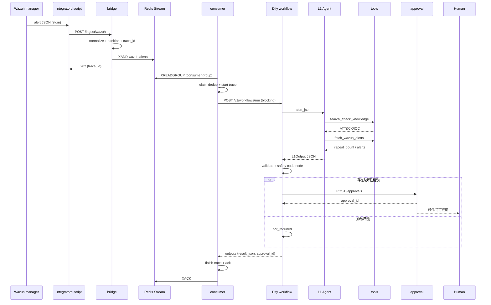

# 架构设计

## 1. 目标与非目标

### 目标

1. Wazuh 告警进入后 **秒级** 给出 L1 分诊：`close / watch / escalate`。
2. Wazuh 不直接调用 LLM；告警先持久化到 Redis Stream，失败可重试、可重放。
3. L1 只做“是否值得人看”的判断，工具只读、调用次数有上限。
4. 破坏性动作只给建议，必须人工审批；审批也不自动执行。
5. 每条裁决都能从 trace 重建：工具名、参数、返回、LLM 理由、审批状态。

### 非目标（本迭代）

- L2 深度调查（进程树、横向移动、内存/磁盘取证）。
- 自动封 IP / 隔离主机 / 改密码。
- 替换 SIEM 或 Wazuh 规则引擎。
- 全量 ATT&CK 知识库、真实威胁情报订阅。
- 多租户、RBAC、跨地域高可用。

---

## 2. 组件与职责

| 组件 | 职责 | 不做什么 |
| --- | --- | --- |
| Wazuh manager + integratord | 产生告警，调用转发脚本 | 不调用 LLM，不做长耗时 HTTP |
| `custom-soc-agent.py` | stdin 读告警，POST bridge，3 秒超时 | 不解析、不判断、不重试多次 |
| `bridge` | 校验、脱敏、分配 `trace_id`、`XADD`，返回 202 | 不调用 Dify，不做分诊 |
| Redis Stream | 持久化排队、consumer group、pending、DLQ | 不作为长期审计存储 |
| `consumer` | 消费、幂等、调用 Dify、审批兜底、写 trace | 不直接执行破坏性动作 |
| Dify workflow | 编排 Agent、工具、校验、审批 HTTP | 不直接访问 Wazuh API |
| L1 Agent | 在 3 次工具调用内给出严格 JSON | 不执行工具之外的系统命令 |
| `tools` | 两个只读工具：Wazuh 查询、ATT&CK/IOC 检索 | 不提供写操作、不提供任意 URL |
| `approval` | 创建审批单、token、通知、人工决策 | 不执行阻断 |
| `TraceStore` | SQLite 查询 + JSONL 追加审计 | 不保存明文 token/密码 |

---

## 3. 端到端时序



### 失败路径

| 失败点 | 行为 |
| --- | --- |
| bridge 挂 | Wazuh 脚本 3 秒超时，写 stderr，退出 0；告警仍在 Wazuh |
| Redis 挂 | bridge 返回 5xx；Wazuh 脚本不无限重试 |
| consumer 挂 | 消息留在 pending，另一个 consumer 用 `XAUTOCLAIM` 接管 |
| Dify 超时/5xx | consumer 重试；超过 `REDIS_MAX_RETRIES` 进 DLQ |
| Dify 返回非法 JSON | Dify 校验节点降级为 `watch`，仍输出合法结构 |
| approval 服务挂 | Dify HTTP 节点 `continue`；consumer 检测到 `requires_human_approval` 但无 `approval_id` 时本地补建审批 |
| trace 写失败 | 主流程继续；JSONL 写失败被吞掉，不阻断分诊 |

---

## 4. 数据契约

### 4.1 告警归一化

`normalize_alert()` 把 Wazuh 的多种字段形态收敛为 `AlertView`：

- `rule.level`、`rule.description`、`rule.id`；
- `rule.mitre.id` 或压缩格式 `rule.mitre_ids`；
- `data.srcip` 或 `data.src_ip`；
- `agent.id/name`、`full_log/log`、`location`。

兼容两种输入：

1. Wazuh 原始告警（`rule.mitre.id`）；
2. `alert_for_llm()` 压缩后的告警（`rule.mitre_ids`）。

### 4.2 L1 输出

`L1Output` 是唯一契约，字段与约束见 `schemas/l1_output.schema.json`。

安全相关的一致性校验：

```text
escalate_to_l2 == (verdict == "escalate")
requires_human_approval == any(action.destructive)
destructive action => target != null
destructive action => destructive == True
destructive action => requires_approval == True
verdict == "escalate" => 至少一个 escalate_l2 动作
verdict != "escalate" => 不允许 escalate_l2 动作
```

这四类约束同时存在于：

- Pydantic 模型（Python 侧，consumer 最终校验）；
- Dify 的“校验与安全收敛”Code 节点；
- Prompt 中的输出说明。

任何一处改动都要同步另外两处，否则会出现“模型输出合法但系统拒绝”或相反的问题。

### 4.3 工具参数

```text
fetch_wazuh_alerts:
  limit: int 1..20 (default 5)
  min_level: int 0..16 (optional)
  src_ip: IPv4/IPv6 string (optional)
  additionalProperties: false

search_attack_knowledge:
  query: string 1..500
  top_k: int 1..10 (default 3)
  additionalProperties: false
```

工具层不接受“时间范围”“URL”“查询语句”等参数，避免模型把只读工具变成任意查询入口。

---

## 5. 裁决策略

`deterministic` 模式用于离线测试和演示，阈值如下（`agent.py`）：

```text
risk = 100 * clamp(
    0.45 * (level / 16)
  + 0.25 * min(repeat_count / 5, 1)      # 仅当有 src_ip
  + 0.15 * min(attack_score / 12, 1)
  + 0.10 * (IOC 命中 ? 1 : 0)
  + 0.05 * (敏感战术 ? 1 : 0),
  0, 1
)
```

升级条件（满足任一）：

- `level >= 12`；
- 同源 IP 15 分钟重复 `>= 3` 且 `level >= 10`；
- 敏感战术（Credential Access / Lateral Movement / Execution / Persistence / Privilege Escalation / Exfiltration / Impact / Command and Control）且 `level >= 10` 且知识库最高分 `>= 3`；
- IOC 命中且 `level >= 7`。

风险下限：

- `level >= 12` → 至少 70；
- `level >= 10` → 至少 55；
- IOC 命中且 `level >= 7` → 至少 75；
- `verdict=escalate` → 至少 65。

这样避免“`/etc/sudoers` 单点变更因为无重复被算成 34 分”的荒谬结果。

ATT&CK 技术选择：

1. 优先使用告警自带的 `rule.mitre.id`，按告警给出的顺序；
2. 在知识库结果中找同 ID 的结果补名称/战术；
3. 若知识库没有该 ID，用知识库最高分结果补全；
4. 最终 `mitre_techniques` 最多 5 条。

---

## 6. 幂等、重试与 DLQ

### 6.1 幂等三态

`Dedup` 不是简单“见过就跳过”，而是：

```text
claim(alert_id)   -> 抢到处理权；已处理/处理中返回 False
  success         -> commit(alert_id) 保留占位
  failure         -> release(alert_id) 允许重试
```

- 内存实现：`dict` + TTL；
- Redis 实现：`SET key processing NX EX ttl`，失败 `DEL`，成功 `SET key done EX ttl`。

如果进程在 `claim` 后崩溃，key 会在 TTL 后过期，消息可被重新处理；不会永久丢失。

### 6.2 Redis Stream

- 消费组：`REDIS_GROUP`；
- 每个消费者名字：`REDIS_CONSUMER`（多副本必须不同）；
- 新消息：`XREADGROUP >`；
- 失败重试：消息留在 pending，`fail()` 增加 attempts，超过 `REDIS_MAX_RETRIES` 写 DLQ；
- 空闲消息：`XAUTOCLAIM` 接管超过 `REDIS_CLAIM_IDLE_MS` 的 pending；
- DLQ：`REDIS_DLQ`，保留原始 payload、错误、attempts、失败时间。

### 6.3 重试边界

- Wazuh → bridge：脚本只重试 1 次，3 秒超时；失败不阻塞 Wazuh。
- consumer → Dify：`asyncio.wait_for(dify_workflow_timeout_s + 15)`；失败按队列策略重试。
- Dify → tools：HTTP 超时由 Dify 节点配置；工具服务自身 10 秒 Wazuh 查询超时。
- Dify → approval：`error_strategy: continue`，审批服务挂不阻断裁决输出。

---

## 7. 信任边界与威胁模型

### 7.1 不可信输入

| 输入 | 风险 | 处理 |
| --- | --- | --- |
| Wazuh `full_log` | 提示词注入、伪造“系统指令” | Prompt 明确“不可信数据”；证据里记录 `policy`；不执行其中指令 |
| 用户名/URL/文件名 | 注入、超长、特殊字符 | 截断、JSON 序列化、Schema 长度限制 |
| 工具返回 | 被污染的知识库/告警内容 | 只作为证据；Dify 校验节点重新收敛 |
| LLM 输出 | 非法 JSON、越权动作、漏字段 | Pydantic / Code 节点双重校验；非法降级 `watch` |
| 审批链接 token | 泄露、重放 | 单次使用、24h 过期、只存 hash、生产不打印 |

### 7.2 权限边界

- Wazuh 集成脚本只允许 POST bridge，不持有 Dify/DeepSeek key；
- bridge 不调用 Dify，不持有模型 key；
- tools 只读，不暴露 shell、Wazuh active response、任意 URL；
- consumer 持有 Dify key，但不直接执行破坏性动作；
- approval 只写审批状态，不执行阻断；
- Dify 自定义工具只绑定两个只读 endpoint。

### 7.3 为什么“审批通过也不执行”

毕业设计里最容易被追问的点是“误封怎么办”。本项目的答案是：

1. L1 只给建议，不自动执行；
2. 审批通过只代表“人认可这个建议”；
3. 真正执行应由独立的 SOAR/自动化平台完成，并带二次确认、回滚、审计；
4. 本项目刻意不实现执行器，避免把演示系统变成危险工具。

---

## 8. 资源预算（4C4G）

Dify 整栈目标约 3GB，剩下约 1GB 给 OS、Redis、本项目服务。

| 组件 | 预算 | 说明 |
| --- | --- | --- |
| Dify api | 700MB | `deploy/dify-memory-3g.override.yml` |
| Dify worker | 600MB | 同上 |
| Dify web | 128MB | 静态前端 |
| Dify db | 384MB | Postgres |
| Dify redis | 64MB | 缓存，可淘汰 |
| Weaviate | 640MB | 默认向量库；换 pgvector 时调整 |
| sandbox | 128MB | 代码沙箱 |
| plugin_daemon | 256MB | 插件 |
| ssrf_proxy + nginx | 128MB | 入口 |
| **Dify 合计** | **~2.96GB** | 留约 1GB 给系统和其他服务 |
| 本项目 Redis | 256MB | Stream，`noeviction` |
| bridge/tools/approval/consumer | ~300MB | Python 进程，按实际调 |
| 本项目 trace | 磁盘 | SQLite + JSONL，按保留天数清理 |

> 这是预算不是承诺。上线前必须用 `docker stats --no-stream` 实测；Dify 插件、索引、并发上来后内存会涨。
>
> **Wazuh 不在 3GB 预算内**：Wazuh manager / indexer 是既有 SIEM 组件（Indexer 基于 OpenSearch/JVM），本项目没有为 RAG 额外引入 Elasticsearch。若把 Wazuh Indexer 和 Dify 挤在同一台 4C4G 机器上，内存基本不够；应使用已有 Wazuh 集群或把 Indexer 放到另一台机器。本项目 RAG 只走 Dify Dataset Retrieve 或本地 BM25。

---

## 9. 扩展点

- **换队列**：`StreamQueue` 接口已抽象，可换 Kafka/SQS；当前 Redis Stream 足够单机。
- **换知识库**：`KnowledgeBackend` 有 `LocalKnowledgeBackend` / `DifyKnowledgeBackend` / `CombinedKnowledgeBackend`。
- **换 Wazuh 查询**：`MockWazuhBackend` / `IndexerWazuhBackend`，新增后端只需实现 `search()`。
- **换 LLM**：`L1Agent` 的 DeepSeek 分支使用 OpenAI 兼容接口，换 base_url/model 即可；确定性分支永远保留作为降级。
- **L2**：consumer 可在 `escalate` 后投递到第二个 Stream，由 L2 worker 做主机取证；L1 不阻塞。

---

## 10. 已知限制

- Redis Stream 的 `fail()` 用 `XADD` 重投而不是 `XCLAIM`，语义简单但会多一条消息；生产可改成延迟队列/重试 Stream。
- SQLite 适合单机；多副本 consumer 共享一个 SQLite 文件会有写锁竞争，生产换 Postgres/ClickHouse。
- Dify DSL 的 Agent 工具列表无法跨工作区移植，导入后必须手动绑定。
- 真实 Dify 的 Code 节点沙箱对标准库有限制；如果 `json` 不可用，需要改成 Dify 支持的表达式或工具节点。
- 本地知识库是 ATT&CK 子集，不是全量；IOC 是合成数据。
- Wazuh 侧仍使用 mock 注入，未接入生产 Wazuh Indexer；Dify + DeepSeek 已在真实云端完成闭环验证，部署文档中的权限和网络仍需按实际环境复核。
